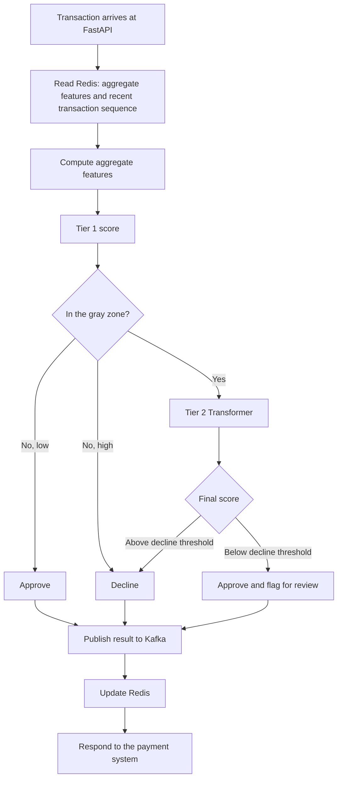
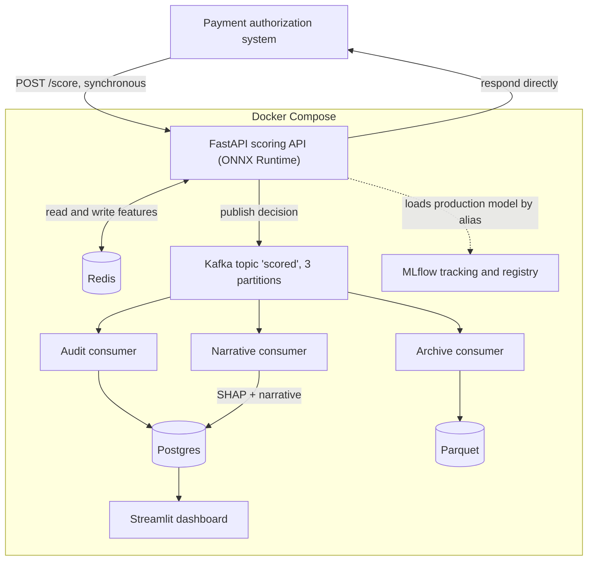

# Realtime Fraud Detection Platform (in progress)

A real-time risk scoring platform for card-not-present payment transactions (the customer types card details into an online form). Every incoming transaction is scored automatically through a two-tier model pipeline and ends in one of three decisions: **decline**, **approve and flag for review**, or **approve normally**. Built end to end on the public [IEEE-CIS Fraud Detection](https://www.kaggle.com/competitions/ieee-fraud-detection) dataset, covering data pipelines, model training and evaluation, low-latency serving, event-driven processing, explainability, MLOps, and model monitoring.

> **Status: in progress.** The data pipeline, both model tiers, the scoring API, the Kafka consumers, and most of the explainability and dashboard work are built and tested. Drift monitoring, retraining automation, load testing, and cloud deployment are still ahead. See [Project status](#project-status) for the exact breakdown.

## Table of contents

- [Why this problem is hard](#why-this-problem-is-hard)
- [How a decision is made](#how-a-decision-is-made)
- [Architecture](#architecture)
- [Key design decisions](#key-design-decisions)
- [Tech stack](#tech-stack)
- [Results so far](#results-so-far)
- [Project status](#project-status)
- [Repository layout](#repository-layout)
- [Getting started](#getting-started)

## Why this problem is hard

- **Extreme class imbalance.** 3.50% of the 590,540 transactions are fraud, so plain accuracy is meaningless. Models are judged on precision-recall metrics (PR-AUC) instead.
- **Errors cost money in both directions.** Approving fraud loses money directly. Declining a legitimate customer damages trust and drives churn. The system treats both mistakes as expensive and sets thresholds from an explicit cost ratio, reported as a sensitivity analysis rather than a single claimed number.
- **Adaptive adversaries and delayed labels.** Fraud patterns drift, and the true label of a transaction only arrives after investigation. Training only uses data whose labels have matured, and splits are strictly temporal (60/20/20) to prevent leakage from the future.
- **No real card or customer identifier.** The dataset only offers `card1`, which on high-volume entities stands for a group of cards, not one card. It is treated throughout as a *technical entity key*, and no explanation shown to a human ever says "this customer" or "this card".
- **Mostly anonymous signals.** The strongest predictors are anonymized columns. Explanations are therefore statistical contribution hints, not business reasons, and the product says so.

## How a decision is made

Three decision classes, not two. A borderline score is **approved and flagged for human review**, so the customer never feels it. Only a high score is declined automatically.

| Risk | Decision | Customer impact |
|---|---|---|
| High | Decline automatically | Transaction rejected immediately |
| Medium / ambiguous | Approve, flag for review | None, the transaction proceeds normally |
| Low | Approve normally | None |



- **Tier 1** scores every transaction from per-entity aggregate features. Four candidates were compared (logistic regression, random forest, LightGBM, XGBoost) and LightGBM won on validation PR-AUC. Its scores are isotonic-calibrated so thresholds can be set from a cost formula.
- **Tier 2** is a custom PyTorch Transformer that reads the entity's recent transaction sequence. It is only called for the gray zone (scores between a lower bound and the decline threshold).
- Entities with little history are **not** treated as a special risky path: the data showed their fraud rate is below the global rate, so a plain default is used for first-time entities.

## Architecture



The decision path is synchronous: the payment system calls `POST /score` and waits. Kafka only receives the result *after* the decision, to fan out three independent downstream jobs without slowing the response.

## Key design decisions

Each of these was a deliberate trade-off, with the rejected alternative recorded.

- **One feature function for batch and online.** Aggregate features are computed by a single Python function called from both the offline batch path and the incremental serving path. Writing two implementations was rejected because of training-serving skew risk. Verified by replaying 3,000 transactions through the serving path, which produced scores identical to the training pipeline (max difference 0).
- **Kafka first, Redis second.** After a decision, the result is published to Kafka before Redis is updated. If Redis fails, the audit and archive consumers still capture the transaction, and Redis can be rebuilt from Parquet. The reverse order could silently lose a transaction from the audit trail.
- **Decisions never wait on Kafka or humans.** If Kafka is down, the API still answers in milliseconds and parks the message in a durable local retry buffer (SQLite, WAL) that is retried in the background. Verified by killing Kafka during a request.
- **At-least-once delivery with idempotent writes.** Offsets are committed only after the write succeeds, and duplicates are dropped by `TransactionID`. A consumer force-killed after writing to Postgres but before committing its offset re-read 40 messages on restart and created zero duplicates. Retried `POST /score` calls return the same decision without recomputation.
- **Three independent consumer groups.** Audit logging, Parquet archiving, and LLM narrative generation read the same topic separately, so a slow or failing LLM cannot block audit or archiving. Killing the narrative consumer left the other two unaffected.
- **Redis is a rebuildable cache.** Postgres holds the audit trail and Parquet holds history. Redis can be wiped and rebuilt from Parquet, verified by a SHA-256 hash over all 27,106 keys matching before and after recovery.
- **Self-contained ONNX models.** The tier 1 model and its calibration are exported as one ONNX graph, so the approved artifact is exactly what serves traffic. The export is gated on decision-level equivalence against the original model.
- **Model promotion is never automatic.** Models move to production only by an explicit human approval that repoints a registry alias. The API picks up the change by polling the registry in the background, with no restart and no infrastructure access granted to the dashboard.
- **Two authentication paths on purpose.** The scoring endpoint uses an API key (machine to machine), the dashboard uses JWT with a role claim (human users). Roles are mutually exclusive in both directions: analysts cannot reach model controls, ML engineers cannot reach the review queue. Automated tests check access in both directions.
- **Pre-registered evaluation criteria.** The pass/fail criteria for the tier 2 experiments were written and committed before any result was seen, and the test split can be evaluated only once per model version (enforced in code).

## Tech stack

| Area | Technology |
|---|---|
| Language and tooling | Python 3.12, uv |
| Serving | FastAPI, Uvicorn, ONNX Runtime |
| Online / offline storage | Redis (HASH and LIST per entity), Parquet partitioned by day |
| Audit and review queue | PostgreSQL |
| Messaging | Apache Kafka (confluent-kafka), three consumer groups |
| Tier 1 models | LightGBM, XGBoost, scikit-learn, Optuna for tuning |
| Tier 2 model | Custom PyTorch Transformer (masked-field pretraining, then fine-tuning), exported to ONNX |
| MLOps | MLflow (experiment tracking and model registry with aliases) |
| Explainability | SHAP (TreeSHAP for tier 1), template narrative, LLM narrative |
| LLM monitoring | Langfuse |
| Dashboard | Streamlit with JWT role-based access |
| Testing | pytest |
| Infrastructure | Docker Compose |

## Results so far

All numbers come from the public dataset on a single development machine. They are offline results, not production claims.

**Tier 1 (LightGBM, calibrated).** Test PR-AUC is **0.5177** (95% bootstrap CI 0.5011 to 0.5337), against a fraud base rate of 3.44%. Validation PR-AUC was 0.6481, so performance dropped noticeably on the later time window. Only about 13% of that gap is explained by the lower fraud rate; most of it comes from a harder final stretch of the validation period, whose cause is not yet known. The test set was deliberately not used for tuning. Results are broken down by entity size and by history position, and entities with little history did not turn out to be weaker.

**Tier 2 (Transformer): did not beat tier 1.** Against a fair baseline (tier 1 plus time-window features), the Transformer lost on every entity-size segment, and shuffling the transaction order barely changed its score, so reading the sequence order is not supported by the evidence. Most of the gap exists even when it sees only the current transaction, which points to the model reading tabular columns poorly rather than misreading order. Because of this, tier 2 currently runs in **shadow mode**: it is called for gray-zone transactions and its score is logged, but it does not influence the decision. On validation data it did rank transactions inside the gray zone better than tier 1, but that cannot be confirmed because the test split was already used, so it stays a hypothesis for fresh data.

**Preliminary latency (not a load test).** Single-threaded ONNX inference for tier 1 measured p99 1.08 ms, and the whole decision function (real Redis, Kafka, and ONNX, 3,000 sequential transactions) measured p50 2.85 ms and p99 5.67 ms. These ignore concurrency and network overhead, so the latency target is still unvalidated.

**Reliability checks that were run for real:** Kafka outage during requests, consumer killed mid-write, Redis rebuilt from Parquet with identical hashes, and 40 and 100 concurrent writers to one entity with no lost updates.

## Project status

| Area | Status |
|---|---|
| Feature store and data pipeline (Redis, Parquet, shared feature function, recovery script) | Done |
| Tier 1 model (candidate comparison, tuning, calibration, cost-based thresholds, ONNX export, one-shot test evaluation) | Done |
| Scoring API (auth, idempotency, per-step timing, Kafka retry buffer, model loading from registry) | Done |
| Kafka consumers (audit, archive, narrative) with failure and duplicate handling | Done |
| Tier 2 Transformer (pretraining, fine-tuning, ONNX export, hypothesis tests, shadow serving) | Done, did not beat tier 1 |
| Explainability (TreeSHAP, V-feature grouping, template and LLM narratives, Langfuse tracing) | Done |
| Dashboard: login, role-based access, analyst review queue | Done, final polish in progress |
| Dashboard: ML engineer model health view | Skeleton in place |
| Drift monitoring (PSI) and scheduled or manual retraining | Planned |
| Model promotion from the dashboard | Planned |
| Load testing and latency validation under realistic traffic | Planned |
| Cloud deployment (single VM, public demo) | Planned |

Unit tests cover authentication, two-way role access, narrative generation and its fallbacks, SHAP output, tracing, and the review queue.

## Repository layout

```
src/fraud/
    features/        Shared feature functions, online and offline stores
    schemas/         Request and message schemas
    serving/         Scoring API, model loader, idempotency, Kafka producer, retry buffer
    consumers/       Audit, archive, and narrative consumers
    training/        Tier 1 and tier 2 training, evaluation, ONNX export
    explainability/  SHAP, template and LLM narratives, tracing
    dashboard/       Streamlit app, analyst/ and ml_engineer/ pages
scripts/             Initial data load, Redis recovery, Kafka topic and Postgres setup
configs/             Thresholds and feature groups produced by experiments
notebooks/           Colab launcher for GPU training of tier 2
tests/unit/          Unit tests
```

Dependency rules are enforced by convention: `serving` never imports `training`, so the API image stays free of PyTorch.

## Getting started

### Prerequisites

- Python 3.12 or newer
- [uv](https://docs.astral.sh/uv/) for dependency management
- Docker Desktop (or Docker Engine with the Compose plugin)
- A Kaggle account

### 1. Clone the repository

```bash
git clone https://github.com/daffaalhanif/realtime-fraud-detection-platform.git
cd realtime-fraud-detection-platform
```

### 2. Install dependencies

```bash
uv sync
```

This creates a `.venv` and installs all dependencies declared in `pyproject.toml`.

### 3. Configure environment variables

```bash
cp .env.example .env
```

Fill in the values in `.env`. `SCORING_API_KEY` and `JWT_SECRET_KEY` should be random strings, for example generated with:

```bash
python3 -c "import secrets; print(secrets.token_hex(32))"
```

### 4. Download the dataset

The raw dataset is not included in this repository and must be downloaded yourself through the Kaggle API.

1. Log in to [Kaggle](https://www.kaggle.com), go to your account settings, and create a new API token. This downloads a `kaggle.json` file.
2. Place that file at `~/.kaggle/kaggle.json`.
3. On the [IEEE-CIS Fraud Detection competition page](https://www.kaggle.com/competitions/ieee-fraud-detection), accept the competition rules. The API download will fail until this step is done.
4. Download and extract the dataset into a local `data/` folder:

```bash
uvx kaggle competitions download -c ieee-fraud-detection -p data/
unzip data/ieee-fraud-detection.zip -d data/
```

The `data/` folder is excluded from version control and must never be committed, because the competition license does not allow redistributing the files.

### 5. Start local infrastructure

```bash
docker compose up -d
```

This starts Redis, Postgres, Kafka, and the MLflow server.

## Limitations

- `card1` is a technical entity key, not a card or a customer, so entity-level features describe group behavior on high-volume keys.
- There is no deterministic rule layer (blacklists, CVV checks) because the dataset lacks the attributes needed.
- Cost ratios for thresholds are assumptions evaluated as scenarios, not verified business numbers.
- Everything runs as a single instance, with no high availability or multi-region setup.
- Latency numbers are offline and unvalidated under load, and this is not a production-ready payment component.
